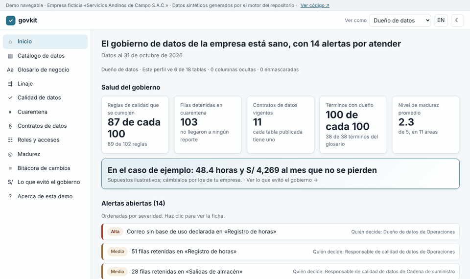
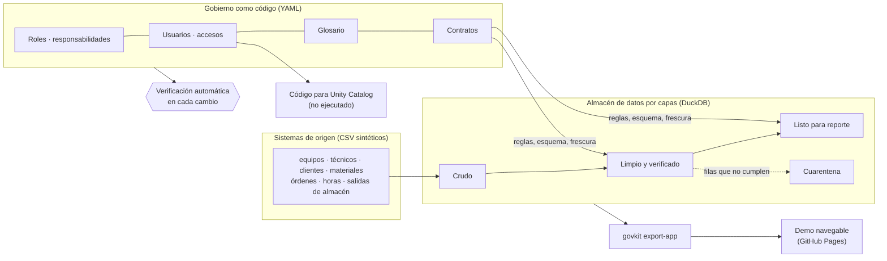

# Gobierno de Datos como Código

[English](README.md) · **Español**

**Un programa de gobierno de datos que se verifica solo, y que se puede recorrer como un software.**

### [▶ Abrir la demo](https://juansanchezalcantara20-ai.github.io/data-governance-as-code/)

[](https://juansanchezalcantara20-ai.github.io/data-governance-as-code/)

**Qué resuelve, en 3 viñetas**

- **Una sola versión de cada número.** 38 términos de negocio con dueño, fórmula y lugar exacto en los datos, y 11 contratos de datos que dicen qué promete cada tabla.
- **Los datos malos no llegan a los reportes.** 102 reglas de calidad detienen 103 filas en cuarentena, y un cambio que rompe un contrato no se puede integrar.
- **Cada quien ve solo lo que le corresponde, y se puede comprobar.** Roles, matriz de responsabilidades y permisos viven en archivos que se verifican en cada cambio; en la demo, el técnico de campo no ve costos y el auditor solo lee.

[](https://github.com/juansanchezalcantara20-ai/data-governance-as-code/actions/workflows/ci.yml)
[](https://juansanchezalcantara20-ai.github.io/data-governance-as-code/)

> Empresa ficticia («Servicios Andinos de Campo S.A.C.») y datos sintéticos. Las cifras ilustran el método; no son
> resultados de ninguna organización real.

---

## La demo

Una aplicación web estática que se ve y se usa como un software de gobierno de datos, con diseño propio. **Cada
número sale del motor del repositorio**: el comando `python -m govkit export-app` escribe los datos de la app y la
verificación automática falla si lo publicado no coincide con lo que produce el motor. La demo no puede mostrar algo
que el motor no hizo.

| Pantalla | Qué muestra |
|---|---|
| Inicio | Salud del gobierno, valor evitado y alertas abiertas con su ficha (qué pasó, qué regla lo detectó, quién decide) |
| Catálogo | 18 tablas por dominio y capa, con dueño, contrato, semáforo de calidad, columnas sensibles y quién las usa |
| Glosario | 38 términos con definición, ejemplo, dueño, términos relacionados y dónde viven en los datos |
| Linaje | Elige una columna de un reporte y se ilumina su camino hasta el archivo de origen |
| Calidad | Las 6 dimensiones explicadas en palabras y las 102 reglas en lenguaje humano |
| Cuarentena | Las 103 filas detenidas, agregadas por motivo, sin mostrar datos personales |
| Contratos | Qué promete cada tabla, quién la produce y la consume, y qué pasa si se rompe |
| Roles y accesos | Matriz de responsabilidades y quién puede ver qué, con los controles de separación de funciones |
| Madurez | Radar de las 11 áreas de gestión de datos, nivel actual frente a la meta y hoja de ruta |
| Bitácora | Las verificaciones reales de cada cambio, incluido uno bloqueado y corregido |
| Lo que evitó el gobierno | Horas y soles al mes, con supuestos que puedes cambiar en vivo |

Arriba a la derecha, **«Ver como»** cambia de perfil (Dueño de datos, Custodio, Analista, Técnico de campo, Auditor)
y la app muestra exactamente lo que dice la política de accesos.

## Capacidades que demuestra

| Capacidad | Dónde está |
|---|---|
| **Responsables de datos** (*data stewardship*) | 8 roles con responsabilidades, decisiones y a quién escalan; matriz de responsabilidades (RACI: quién hace, quién aprueba, a quién se consulta, a quién se informa) para 9 actividades; un dueño y un responsable de calidad por dominio, contrato y término. |
| **Glosario de negocio** | 38 términos en español e inglés, validados contra definiciones circulares y términos sin uso. |
| **Contratos de datos** | 11 contratos en el estándar abierto ODCS v3 (*Open Data Contract Standard*), verificados contra el dato real en cada corrida; un cambio que rompe hace fallar la verificación ([ejemplo](docs/es/ejemplo-cambio-que-rompe.md)). |
| **Reglas de calidad** | 102 reglas ejecutables en completitud, unicidad, validez, consistencia, exactitud y oportunidad, con cuarentena y reporte en cada corrida. |
| **Linaje** | Linaje por columna leído del código SQL, desde el archivo de origen hasta el tablero, con análisis de impacto. |
| **Clasificación y control de accesos** | Cuatro niveles de clasificación, también por columna; mínimo privilegio por rol; permisos temporales con vencimiento; separación de funciones; enmascaramiento de datos personales; permisos generados desde la política. |
| **Marco DAMA-DMBOK2** | Autoevaluación con evidencia en las 11 áreas de la guía de la asociación internacional de gestión de datos, y hoja de ruta priorizada. |
| **Valor** | Lo que el gobierno evitó, en horas y soles, con supuestos ilustrativos y editables ([`governance/supuestos_valor.yaml`](governance/supuestos_valor.yaml)). |
| **Preparado para plataforma** | Código para Databricks Unity Catalog (catálogo, tablas, etiquetas, permisos y máscaras) generado desde la misma política. [No se ha ejecutado](docs/es/despliegue-unity-catalog.md). |

El mismo motor gobierna también el catálogo de indicadores de mi
[proyecto de KPI](https://github.com/juansanchezalcantara20-ai/kpi-catalog-storytelling): aparece en la demo como el
dominio «Indicadores (proyecto 2)».

## Arquitectura



- **Crudo** guarda la fuente tal como llegó; **Limpio** estandariza y retiene lo que no cumple; **Listo para reporte**
  publica los productos de datos que prometen los contratos.
- La verificación automática (integración continua, CI) corre en cada cambio: linter, validadores de gobierno,
  pipeline, verificación contra contratos, documentos generados, datos de la app, las pruebas en Python y pruebas de
  navegador en escritorio y celular.

## Cómo correrlo

Requiere Python 3.10+ y `make`.

```bash
make install
make all
```

Para ver la app en tu máquina:

```bash
python -m http.server --directory app 8000
```

y abre `http://localhost:8000`. Las pruebas de navegador necesitan Node.js: `npm install`, `npx playwright install chromium` y `npm run e2e`.

Documentación técnica: [docs/es/README.md](docs/es/README.md) · publicada en
[/docs/](https://juansanchezalcantara20-ai.github.io/data-governance-as-code/docs/).

## Cómo se construyó

Diseñé y dirigí este proyecto y lo construí con [Claude Code](https://claude.com/claude-code) como agente de
programación. El modelo de gobierno, las reglas y sus umbrales, las decisiones y la revisión son míos; el razonamiento
detrás de cada elección está en [`docs/es/decisiones.md`](docs/es/decisiones.md).

## Alcance y limitaciones

- **Solo datos sintéticos** de una empresa ficticia, con errores sembrados a propósito. Los hallazgos ilustran el
  método; no son resultados.
- **La demo es estática:** no hay inicio de sesión; el cambio de perfil y los botones de acción son simulados.
- **Los montos de valor son supuestos ilustrativos**, no estimaciones de ninguna empresa. No se estiman multas.
- **No es una plataforma productiva:** DuckDB en un solo nodo y cargas por lotes. El código de Unity Catalog no se ha
  ejecutado.
- **Autoevaluación, no auditoría:** la madurez usa una escala propia y aplica solo a este repositorio.

## Contribuir

Ver [CONTRIBUTING.md](CONTRIBUTING.md) (en inglés). El historial de versiones está en [CHANGELOG.md](CHANGELOG.md).

## Licencia

MIT
