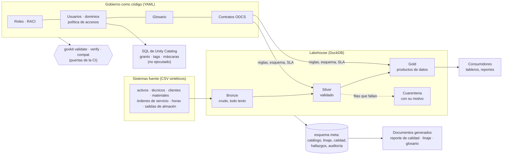

# Gobierno de Datos como Código

[English](README.md) · **Español**

[](https://github.com/juansanchezalcantara20-ai/data-governance-as-code/actions/workflows/ci.yml)

Un programa de gobierno de datos que funciona, montado para una empresa **ficticia** de servicios de campo:
roles y matriz RACI, usuarios y accesos con mínimo privilegio, glosario de negocio, contratos de datos ODCS v3,
reglas de calidad en seis dimensiones, linaje de punta a punta y una autoevaluación de madurez DAMA-DMBOK2.
Cada pieza vive en YAML versionado y tiene un validador automático, así que **la CI falla cuando el gobierno se
rompe**, igual que falla cuando se rompe el código.

> La versión en inglés es la fuente principal; esta traducción se mantiene al día con ella. El código, los
> nombres de archivo de gobierno y los términos de los estándares (ODCS, RACI, DAMA) quedan en inglés.

## Recorrido de cinco minutos

| Si quieres ver… | Abre |
|---|---|
| Quién decide qué (roles y matriz RACI) | [`docs/generated/operating_model.md`](docs/generated/operating_model.md) |
| Quién puede leer qué, y por qué | [`docs/generated/access_model.md`](docs/generated/access_model.md) · [`access_grants.sql`](docs/generated/access_grants.sql) |
| El glosario de negocio (38 términos) | [`docs/generated/glossary.md`](docs/generated/glossary.md) · versión con buscador [`glossary.html`](docs/generated/glossary.html) |
| Los contratos de datos | [`docs/generated/contracts.md`](docs/generated/contracts.md) · por ejemplo [`gold.service_order_economics`](contracts/gold.service_order_economics.odcs.yaml) |
| Un cambio de esquema que hace fallar la CI | [`docs/es/ejemplo-cambio-que-rompe.md`](docs/es/ejemplo-cambio-que-rompe.md) |
| El reporte de calidad de la última corrida | [`docs/generated/quality_report.md`](docs/generated/quality_report.md) |
| El linaje desde el archivo fuente hasta el tablero | [`docs/generated/lineage.md`](docs/generated/lineage.md) |
| La autoevaluación de madurez y la hoja de ruta | [`docs/generated/maturity.md`](docs/generated/maturity.md) |
| Por qué las cosas son como son | [`docs/es/decisiones.md`](docs/es/decisiones.md) |

Todo lo que está en `docs/generated/` y `deploy/unity_catalog/` lo produce `govkit docs` a partir del YAML;
la CI lo vuelve a generar y falla si la copia del repositorio está desactualizada.

## El problema

Los programas de gobierno suelen quedarse en documentos: un RACI en una diapositiva, un glosario en una hoja de
cálculo, las reglas de acceso en un correo. Nadie los verifica, así que en pocas semanas ya no coinciden con los
datos. Este proyecto trata cada pieza de gobierno como código con su prueba:

| Pieza | Dónde vive | La CI falla cuando… |
|---|---|---|
| Roles y RACI | `governance/roles.yaml`, `raci.yaml` | una actividad tiene cero o dos Accountable, ningún Responsible o cita un rol que no existe |
| Dominios, usuarios, accesos | `governance/domains.yaml`, `users.yaml`, `access_policy.yaml`, `classification.yaml` | un dominio no tiene Owner, un Owner no tiene Steward, alguien tiene un acceso que ningún rol justifica, o quien pidió un acceso lo aprobó |
| Glosario de negocio | `governance/glossary.yaml` | un Owner no existe, una métrica no tiene fórmula o fuente, una definición es circular o un término no se usa en ningún lado |
| Contratos de datos (ODCS v3) | `contracts/*.odcs.yaml` | el dato real no cumple su contrato, o un cambio que rompe se publica sin subir la versión mayor |
| Reglas de calidad | contratos + glosario | falla una regla bloqueante en un dataset publicado (gold) |
| Autoevaluación de madurez | `governance/maturity.yaml` | un puntaje cita evidencia que no existe en el repositorio |

## Arquitectura



- **Bronze** guarda la fuente tal como llegó. **Silver** estandariza (dos formatos de fecha, mayúsculas y
  espacios sueltos, duplicados) y manda a cuarentena las filas que rompen una regla bloqueante. **Gold** publica
  los productos de datos que prometen los contratos.
- El orden de construcción, el linaje y el catálogo se derivan del SQL; nada se mantiene a mano.

## Cómo correrlo

Requiere Python 3.10+ y `make`.

```bash
make install
make all
```

`make all` corre el linter, valida todo el YAML de gobierno, genera los datos con semilla fija, ejecuta el
pipeline, verifica el dato contra cada contrato, regenera la documentación y corre las pruebas. Pasos sueltos:

```bash
python -m govkit validate                                         # verificaciones de gobierno como código
python -m govkit run                                              # bronze → silver → gold + reporte de calidad
python -m govkit verify                                           # dato contra contratos
python -m govkit lineage gold.site_monthly_kpis.gross_margin_pct  # ¿de dónde sale este número?
python -m govkit lineage silver.technicians.hourly_cost --impact  # ¿qué se rompe si esto cambia?
python -m govkit compat --base origin/main                        # política de cambios de los contratos
python -m govkit deploy                                           # SQL de Unity Catalog (no ejecutado)
```

O con Docker: `docker compose up --build`.

## Qué demuestra

| Lo que pide el puesto | Dónde está en este repositorio |
|---|---|
| **Data stewardship** | Ocho roles con responsabilidades, decisiones y escalamiento; RACI de nueve actividades; un Owner y un Steward por dominio, contrato y término del glosario ([modelo operativo](docs/generated/operating_model.md)). |
| **Glosario de negocio** | 38 términos con definición, Owner, Steward, fórmula, columna fuente, reglas asociadas, sinónimos, términos relacionados, estado y fecha de revisión; validado contra circularidad y términos huérfanos ([glosario](docs/generated/glossary.md)). |
| **Contratos de datos** | Contratos ODCS v3 con esquema, tipos, nulabilidad, claves, clasificación, SLA, reglas, versión y política de cambios; verificados contra el dato en cada corrida; los cambios que rompen hacen fallar la CI ([ejemplo](docs/es/ejemplo-cambio-que-rompe.md)). |
| **Reglas de calidad** | 102 reglas ejecutables en completitud, unicidad, validez, consistencia, exactitud y oportunidad; cuarentena en lugar de pérdida silenciosa; reporte por dataset y por dimensión ([reporte](docs/generated/quality_report.md)). |
| **Linaje** | Linaje a nivel de columna leído del SQL, desde el archivo fuente hasta el consumidor, con análisis de impacto ([linaje](docs/generated/lineage.md)). |
| **Clasificación y control de accesos** | Clasificación de cuatro niveles, mínimo privilegio por rol, excepciones con vencimiento, segregación de funciones, descubrimiento y enmascaramiento de datos personales, GRANTs generados desde la política ([modelo de accesos](docs/generated/access_model.md)). |
| **DAMA-DMBOK2** | Autoevaluación con evidencia sobre las 11 áreas de conocimiento y hoja de ruta priorizada ([madurez](docs/generated/maturity.md)); las dimensiones de calidad y los roles siguen el vocabulario del DMBOK. |
| **Preparado para plataforma** | Catálogo, tablas, tags, grants y máscaras de columna de Unity Catalog generados desde el mismo YAML ([guía de despliegue](docs/es/despliegue-unity-catalog.md)). |

## Resultados ilustrativos (datos sintéticos)

Con el dataset de semilla fija (fecha de corte 2026-10-31), el pipeline pone en cuarentena **103 filas** en tres
tablas silver: órdenes sin activo o cerradas antes de abrirse, horas fuera del rango 0,5–24, líneas huérfanas y
costos de materiales desplazados un decimal (los atrapa la regla de *exactitud* contra el maestro de materiales).
También reporta un hallazgo abierto de severidad alta: la columna `approver_email` contiene datos personales que
ningún contrato declara.

> Estos defectos se **inyectaron a propósito** en el generador (listados en `src/govkit/generator.py` y en
> `data/sources/_manifest.json`). Las cifras ilustran el método; no son hallazgos sobre ninguna organización real.

## Mapa del repositorio

```
governance/            roles, RACI, dominios, usuarios, clasificación, política de accesos, glosario, madurez (YAML)
contracts/             un contrato ODCS v3 por dataset publicado
models/                modelos SQL (silver, gold), registro de fuentes, consumidores (exposures)
src/govkit/            pipeline, motor de calidad, linaje, privacidad, validadores, generadores, CLI
tests/                 pruebas pytest (validadores, contratos, calidad, linaje, despliegue, enlaces)
docs/                  estado, decisiones, ejemplo, documentación generada; docs/es/ en español
deploy/unity_catalog/  SQL generado para Databricks — no ejecutado en este repositorio
```

## Cómo se construyó

Diseñé y dirigí este proyecto, y lo construí con [Claude Code](https://claude.com/claude-code) como agente de
programación. El modelo de gobierno, las reglas y sus umbrales, las decisiones y la revisión son míos; el
razonamiento detrás de cada elección está en [`docs/es/decisiones.md`](docs/es/decisiones.md) y el avance en
[`docs/STATUS.md`](docs/STATUS.md).

## Alcance y limitaciones

- **Solo datos sintéticos.** Una empresa ficticia; todas las personas, sedes y fabricantes son inventados. Los
  hallazgos de calidad ilustran el método, no son resultados.
- **No es una plataforma productiva.** DuckDB en un solo nodo, ingesta por lotes de CSV, sin orquestador y sin
  respaldos.
- **El control de accesos se modela, pero no se aplica, en local.** DuckDB no tiene GRANT; la política se valida
  y se compila a SQL de PostgreSQL y de Unity Catalog, y el enmascaramiento se aplica en Python. El SQL de Unity
  Catalog **no** se ha ejecutado.
- **Sin interfaz de usuario ni herramienta de catálogo.** La documentación se genera en Markdown/HTML; publicarla
  en un catálogo (OpenMetadata, Unity Catalog) está en la hoja de ruta.
- **Autoevaluación, no auditoría.** Los puntajes DAMA-DMBOK2 usan la escala propia del proyecto y aplican solo a
  este repositorio.
- **Un rol por persona**, y los indicadores de gobierno todavía no se siguen en el tiempo (ver la hoja de ruta).

## Contribuir

Ver [CONTRIBUTING.md](CONTRIBUTING.md) (en inglés): cómo proponer un término, una regla o un cambio de contrato, y
quién lo aprueba según la matriz RACI. El historial de versiones está en [CHANGELOG.md](CHANGELOG.md).

## Licencia

MIT
