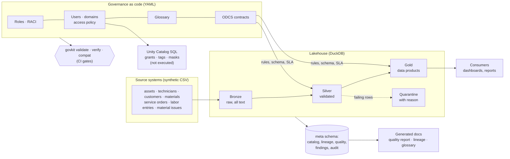

# Data Governance as Code

[](https://github.com/juansanchezalcantara20-ai/data-governance-as-code/actions/workflows/ci.yml)

A working data governance programme for a **fictional** field-services company: roles and RACI, users and
least-privilege access, a business glossary, ODCS v3 data contracts, quality rules in six dimensions,
end-to-end lineage and a DAMA-DMBOK2 maturity assessment. Every one of them lives in versioned YAML and has an
automated validator, so **CI fails when the governance breaks**, the same way it fails when code breaks.

## Five-minute tour

| If you want to see… | Open |
|---|---|
| Who decides what (roles, RACI matrix) | [`docs/generated/operating_model.md`](docs/generated/operating_model.md) |
| Who can read what, and why | [`docs/generated/access_model.md`](docs/generated/access_model.md) · [`access_grants.sql`](docs/generated/access_grants.sql) |
| The business glossary (38 terms) | [`docs/generated/glossary.md`](docs/generated/glossary.md) · searchable [`glossary.html`](docs/generated/glossary.html) |
| The data contracts | [`docs/generated/contracts.md`](docs/generated/contracts.md) · e.g. [`gold.service_order_economics`](contracts/gold.service_order_economics.odcs.yaml) |
| A schema change failing CI | [`docs/examples/breaking-change.md`](docs/examples/breaking-change.md) |
| The quality report of the last run | [`docs/generated/quality_report.md`](docs/generated/quality_report.md) |
| Lineage from source file to dashboard | [`docs/generated/lineage.md`](docs/generated/lineage.md) |
| Maturity self-assessment and roadmap | [`docs/generated/maturity.md`](docs/generated/maturity.md) |
| Why things are the way they are | [`docs/DECISIONS.md`](docs/DECISIONS.md) |

Everything under `docs/generated/` and `deploy/unity_catalog/` is produced from the YAML by `govkit docs`;
CI regenerates it and fails if the committed copy is stale.

## The problem

Governance programmes often stall as documents: a RACI in a slide, a glossary in a spreadsheet, access rules in
an email. Nothing checks them, so they drift away from the data within weeks. This project treats each
governance artefact as code with a test:

| Artefact | Lives in | Fails CI when… |
|---|---|---|
| Roles and RACI | `governance/roles.yaml`, `raci.yaml` | an activity has zero or two Accountables, no Responsible, or cites an unknown role |
| Domains, users, access | `governance/domains.yaml`, `users.yaml`, `access_policy.yaml`, `classification.yaml` | a domain has no Owner, an Owner has no Steward, someone holds access no role justifies, or a requester approved their own request |
| Business glossary | `governance/glossary.yaml` | an owner does not exist, a metric has no formula or source, a definition is circular, or a term is used nowhere |
| Data contracts (ODCS v3) | `contracts/*.odcs.yaml` | the real data does not match the contract, or a breaking change ships without a major version |
| Quality rules | contracts + glossary | a blocking rule fails on a published (gold) dataset |
| Maturity assessment | `governance/maturity.yaml` | a score cites evidence that does not exist in the repo |

## Architecture



- **Bronze** keeps the source exactly as received. **Silver** standardises (two date formats, stray casing,
  duplicates) and quarantines rows that break a blocking rule. **Gold** publishes the data products the
  contracts promise.
- Build order, lineage and the catalog are derived from the SQL; nothing is maintained by hand.

## Run it

Requires Python 3.10+ and `make`.

```bash
make install
make all
```

`make all` lints, validates every governance YAML, generates the seeded data, runs the pipeline, verifies the data
against every contract, regenerates the docs and runs the tests (66). Individual steps:

```bash
python -m govkit validate                                       # governance-as-code checks
python -m govkit run                                            # bronze → silver → gold + quality report
python -m govkit verify                                         # data vs contracts
python -m govkit lineage gold.site_monthly_kpis.gross_margin_pct  # where does this number come from?
python -m govkit lineage silver.technicians.hourly_cost --impact  # what breaks if this changes?
python -m govkit compat --base origin/main                      # contract change policy
python -m govkit deploy                                         # Unity Catalog SQL (not executed)
```

Or with Docker: `docker compose up --build`.

## What this demonstrates

| Skill the role asks for | Where it is in this repo |
|---|---|
| **Data stewardship** | Six roles with responsibilities, decisions and escalation; RACI for nine activities; one Owner and Steward per domain, contract and glossary term ([operating model](docs/generated/operating_model.md)). |
| **Business glossary** | 38 terms with definition, owner, steward, formula, source column, linked rules, synonyms, related terms, status and review date; validated for circularity and orphans ([glossary](docs/generated/glossary.md)). |
| **Data contracts** | ODCS v3 contracts with schema, types, nullability, keys, classification, SLA, rules, version and change policy; verified against the data on every run; breaking changes fail CI ([example](docs/examples/breaking-change.md)). |
| **Data quality rules** | 102 executable rules across completeness, uniqueness, validity, consistency, accuracy and timeliness; quarantine instead of silent loss; report per dataset and dimension ([report](docs/generated/quality_report.md)). |
| **Lineage** | Column-level lineage parsed from SQL, from source file to consumer, with impact analysis ([lineage](docs/generated/lineage.md)). |
| **Classification and access control** | Four-level classification, least-privilege baseline per role, time-bound exceptions, segregation of duties, personal-data discovery and masking, GRANTs compiled from policy ([access model](docs/generated/access_model.md)). |
| **DAMA-DMBOK2** | Evidence-backed self-assessment over the 11 knowledge areas and a prioritised roadmap ([maturity](docs/generated/maturity.md)); quality dimensions and roles follow the DMBOK vocabulary. |
| **Platform readiness** | Unity Catalog catalog, tables, tags, grants and column masks generated from the same YAML ([deploy/unity_catalog](deploy/unity_catalog/README.md)). |

## Illustrative results (synthetic data)

On the seeded dataset (as of 2026-10-31) the pipeline quarantines **103 rows** across three silver tables:
orders without an asset or closed before they opened, hours outside 0.5–24, orphan lines, and material costs
shifted by a decimal place (caught by the *accuracy* rule against the material master). It also reports one
open high-severity finding: an `approver_email` column holds personal data that no contract declares.

> These defects were **injected on purpose** by the generator (listed in `src/govkit/generator.py` and
> `data/sources/_manifest.json`). The numbers illustrate the method; they are not findings about any real
> organisation.

## Repository map

```
governance/         roles, RACI, domains, users, classification, access policy, glossary, maturity (YAML)
contracts/          one ODCS v3 contract per published dataset
models/             SQL models (silver, gold), source registry, consumers (exposures)
src/govkit/         pipeline, quality engine, lineage, privacy, validators, generators, CLI
tests/              pytest suite (governance validators, contracts, quality, lineage, deployment)
docs/               STATUS, DECISIONS, worked example, generated documentation
deploy/unity_catalog/  generated Databricks SQL — not executed in this repo
```

## How this was built

I designed and directed this project and built it with [Claude Code](https://claude.com/claude-code) as the
coding agent. The governance model, the rules and their thresholds, the trade-offs and the review are mine;
the reasoning behind each choice is recorded in [`docs/DECISIONS.md`](docs/DECISIONS.md) and progress in
[`docs/STATUS.md`](docs/STATUS.md).

## Scope & limitations

- **Synthetic data only.** One fictional company; every person, site and manufacturer is invented. Quality
  findings illustrate the method, they are not results.
- **Not a production platform.** Single-node DuckDB, batch CSV ingestion, no scheduler, no backups.
- **Access control is modelled, not enforced, locally.** DuckDB has no GRANT; the policy is validated and
  compiled to PostgreSQL and Unity Catalog SQL, and masking is applied in Python. The Unity Catalog SQL has
  **not** been executed.
- **No user interface or catalog tool.** Documentation is generated Markdown/HTML; publishing to a catalog
  (OpenMetadata, Unity Catalog) is on the roadmap.
- **Self-assessment, not an audit.** The DAMA-DMBOK2 scores use this project's own scale and apply only to
  this repository.
- **One role per person**, and governance KPIs are not yet tracked over time (see the roadmap).

## License

MIT
