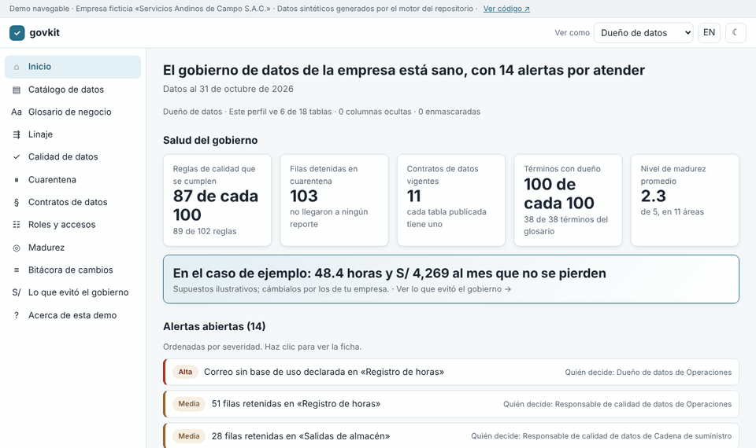
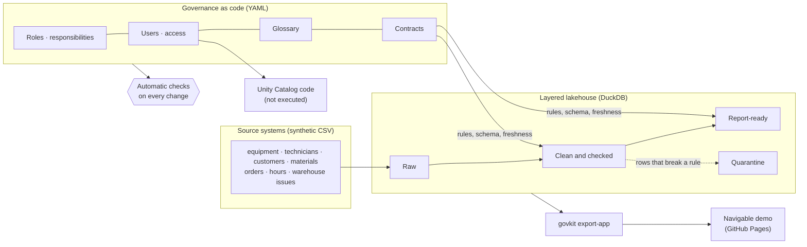

# Data Governance as Code

**English** · [Español](README.es.md)

**A data governance programme that checks itself, and that you can walk through like a piece of software.**

### [▶ Open the demo](https://juansanchezalcantara20-ai.github.io/data-governance-as-code/)

[](https://juansanchezalcantara20-ai.github.io/data-governance-as-code/)

**What it solves, in 3 bullets**

- **One version of every number.** 38 business terms with an owner, a formula and an exact place in the data, and 11
  data contracts that state what each table promises.
- **Bad data never reaches reports.** 102 quality rules hold 103 rows in quarantine, and a change that breaks a
  contract cannot be merged.
- **Everyone sees only what they should, and it can be proven.** Roles, responsibilities and permissions live in files
  checked on every change; in the demo the field technician sees no costs and the auditor can only read.

[](https://github.com/juansanchezalcantara20-ai/data-governance-as-code/actions/workflows/ci.yml)
[](https://juansanchezalcantara20-ai.github.io/data-governance-as-code/)

> Fictional company ("Servicios Andinos de Campo S.A.C.") and synthetic data. Figures illustrate the method; they are
> not results about any real organisation.

---

## The demo

A static web app that looks and works like a data governance tool, with its own design. **Every number comes from
the repository's engine**: `python -m govkit export-app` writes the app's data, and the automatic checks fail if what
is published differs from what the engine produces. The demo cannot show anything the engine did not do.

| Screen | What it shows |
|---|---|
| Home | Governance health, value avoided and open alerts with their details (what happened, which rule caught it, who decides) |
| Catalog | 18 tables by domain and layer, with owner, contract, quality light, sensitive columns and who uses them |
| Glossary | 38 terms with definition, example, owner, related terms and where they live in the data |
| Lineage | Pick a report column and its path back to the source file lights up |
| Quality | The 6 dimensions explained in words and all 102 rules in plain language |
| Quarantine | The 103 rows held, aggregated by reason, with no personal data shown |
| Contracts | What each table promises, who produces and consumes it, and what happens if it breaks |
| Roles and access | Responsibility matrix and who can see what, with segregation-of-duties checks |
| Maturity | Radar of the 11 data management areas, current level versus target, and the roadmap |
| Change log | The real checks on every change, including one blocked and then fixed |
| What governance avoided | Hours and soles per month, with assumptions you can change live |

Top right, **"View as"** switches persona (Data owner, Custodian, Analyst, Field technician, Auditor) and the app shows
exactly what the access policy says. The app opens in Spanish; switch to English with the EN button.

## Capabilities it demonstrates

| Capability | Where |
|---|---|
| **Data stewardship** | 8 roles with responsibilities, decisions and escalation; a responsibility matrix (RACI: who does, who approves, who is consulted, who is informed) for 9 activities; one owner and one steward per domain, contract and term. |
| **Business glossary** | 38 terms in Spanish and English, validated against circular definitions and unused terms. |
| **Data contracts** | 11 contracts in the open ODCS v3 standard (Open Data Contract Standard), verified against the real data on every run; a breaking change fails the checks ([example](docs/examples/breaking-change.md)). |
| **Quality rules** | 102 executable rules across completeness, uniqueness, validity, consistency, accuracy and timeliness, with quarantine and a report on every run. |
| **Lineage** | Column-level lineage parsed from the SQL code, from source file to dashboard, with impact analysis. |
| **Classification and access control** | Four classification levels, also per column; least privilege by role; expiring temporary grants; segregation of duties; personal-data masking; grants generated from the policy. |
| **DAMA-DMBOK2 framework** | Evidence-backed self-assessment across the 11 knowledge areas of the international data management association's guide, plus a prioritised roadmap. |
| **Value** | What governance avoided, in hours and soles, under illustrative, editable assumptions ([`governance/supuestos_valor.yaml`](governance/supuestos_valor.yaml)). |
| **Platform readiness** | Databricks Unity Catalog code (catalog, tables, tags, grants and masks) generated from the same policy. [Not executed](deploy/unity_catalog/README.md). |

The same engine also governs the KPI catalog of my
[KPI project](https://github.com/juansanchezalcantara20-ai/kpi-catalog-storytelling); it appears in the demo as the
domain "KPIs (project 2)".

## Architecture



- **Raw** keeps the source exactly as received; **Clean** standardises and holds back what breaks a rule;
  **Report-ready** publishes the data products the contracts promise.
- Continuous integration (CI) runs on every change: linter, governance validators, pipeline, data-versus-contract
  verification, generated docs, app data, the Python test suite and browser tests on desktop and mobile.

## Run it

Requires Python 3.10+ and `make`.

```bash
make install
make all
```

To view the app locally:

```bash
python -m http.server --directory app 8000
```

then open `http://localhost:8000`. Browser tests need Node.js: `npm install`, `npx playwright install chromium` and `npm run e2e`.

Technical documentation: [docs/README.md](docs/README.md) · published at
[/docs/](https://juansanchezalcantara20-ai.github.io/data-governance-as-code/docs/).

## How this was built

I designed and directed this project and built it with [Claude Code](https://claude.com/claude-code) as the coding
agent. The governance model, the rules and their thresholds, the trade-offs and the review are mine; the reasoning
behind each choice is in [`docs/DECISIONS.md`](docs/DECISIONS.md).

## Scope & limitations

- **Synthetic data only**, for a fictional company, with defects planted on purpose. Findings illustrate the method;
  they are not results.
- **The demo is static:** there is no sign-in; the persona switch and the action buttons are simulated.
- **Value amounts are illustrative assumptions**, not estimates about any company. No fines are estimated.
- **Not a production platform:** single-node DuckDB and batch loads. The Unity Catalog code has not been executed.
- **Self-assessment, not an audit:** maturity uses the project's own scale and applies to this repository only.

## Contributing

See [CONTRIBUTING.md](CONTRIBUTING.md). Release history is in [CHANGELOG.md](CHANGELOG.md).

## License

MIT
