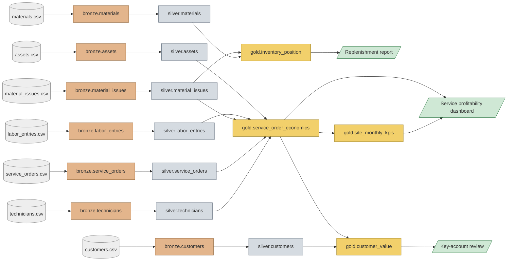

<!-- Generated by `govkit docs`. Do not edit by hand. -->

# End-to-end lineage

Generated from the SQL models with sqlglot (never drawn by hand): source files → bronze → silver → gold → consumers (`models/exposures.yaml`).

## Column-level lineage of gold metrics

| Gold column | Upstream columns (all levels) |
|---|---|
| `gold.customer_value.company_name` | `file:customers.csv.company_name`, `silver.customers.company_name` |
| `gold.customer_value.contact_email` | `file:customers.csv.contact_email`, `silver.customers.contact_email` |
| `gold.customer_value.contact_name` | `file:customers.csv.contact_name`, `silver.customers.contact_name` |
| `gold.customer_value.country` | `file:customers.csv.country`, `silver.customers.country` |
| `gold.customer_value.customer_id` | `file:customers.csv.customer_id`, `silver.customers.customer_id` |
| `gold.customer_value.customer_tier` | `file:service_orders.csv.price`, `silver.service_orders.price` |
| `gold.customer_value.gross_margin` | `file:labor_entries.csv.hours`, `file:material_issues.csv.quantity`, `file:material_issues.csv.unit_cost`, `file:service_orders.csv.price`, `file:technicians.csv.hourly_cost`, `silver.labor_entries.hours`, `silver.material_issues.line_cost`, `silver.service_orders.price`, `silver.technicians.hourly_cost` |
| `gold.customer_value.last_order_on` | `file:service_orders.csv.opened_on`, `silver.service_orders.opened_on` |
| `gold.customer_value.marketing_consent` | `file:customers.csv.marketing_consent`, `silver.customers.marketing_consent` |
| `gold.customer_value.revenue` | `file:service_orders.csv.price`, `silver.service_orders.price` |
| `gold.customer_value.segment` | `file:customers.csv.segment`, `silver.customers.segment` |
| `gold.inventory_position.below_reorder_point` | `file:materials.csv.reorder_point`, `file:materials.csv.stock_on_hand`, `silver.materials.reorder_point`, `silver.materials.stock_on_hand` |
| `gold.inventory_position.category` | `file:materials.csv.category`, `silver.materials.category` |
| `gold.inventory_position.days_of_cover` | `file:material_issues.csv.quantity`, `file:materials.csv.stock_on_hand`, `silver.material_issues.quantity`, `silver.materials.stock_on_hand` |
| `gold.inventory_position.description` | `file:materials.csv.description`, `silver.materials.description` |
| `gold.inventory_position.issued_qty_90d` | `file:material_issues.csv.quantity`, `silver.material_issues.quantity` |
| `gold.inventory_position.material_id` | `file:materials.csv.material_id`, `silver.materials.material_id` |
| `gold.inventory_position.reorder_point` | `file:materials.csv.reorder_point`, `silver.materials.reorder_point` |
| `gold.inventory_position.stock_on_hand` | `file:materials.csv.stock_on_hand`, `silver.materials.stock_on_hand` |
| `gold.inventory_position.stock_value` | `file:materials.csv.stock_on_hand`, `file:materials.csv.unit_cost`, `silver.materials.stock_on_hand`, `silver.materials.unit_cost` |
| `gold.service_order_economics.actual_cost` | `file:labor_entries.csv.hours`, `file:material_issues.csv.quantity`, `file:material_issues.csv.unit_cost`, `file:technicians.csv.hourly_cost`, `silver.labor_entries.hours`, `silver.material_issues.line_cost`, `silver.technicians.hourly_cost` |
| `gold.service_order_economics.actual_hours` | `file:labor_entries.csv.hours`, `silver.labor_entries.hours` |
| `gold.service_order_economics.actual_labor_cost` | `file:labor_entries.csv.hours`, `file:technicians.csv.hourly_cost`, `silver.labor_entries.hours`, `silver.technicians.hourly_cost` |
| `gold.service_order_economics.actual_material_cost` | `file:material_issues.csv.quantity`, `file:material_issues.csv.unit_cost`, `silver.material_issues.line_cost` |
| `gold.service_order_economics.asset_id` | `file:service_orders.csv.asset_id`, `silver.service_orders.asset_id` |
| `gold.service_order_economics.asset_type` | `file:assets.csv.asset_type`, `silver.assets.asset_type` |
| `gold.service_order_economics.closed_on` | `file:service_orders.csv.closed_on`, `silver.service_orders.closed_on` |
| `gold.service_order_economics.cost_variance_pct` | `file:labor_entries.csv.hours`, `file:material_issues.csv.quantity`, `file:material_issues.csv.unit_cost`, `file:service_orders.csv.planned_labor_cost`, `file:service_orders.csv.planned_material_cost`, `file:technicians.csv.hourly_cost`, `silver.labor_entries.hours`, `silver.material_issues.line_cost`, `silver.service_orders.planned_labor_cost`, `silver.service_orders.planned_material_cost`, `silver.technicians.hourly_cost` |
| `gold.service_order_economics.customer_id` | `file:service_orders.csv.customer_id`, `silver.service_orders.customer_id` |
| `gold.service_order_economics.gross_margin` | `file:labor_entries.csv.hours`, `file:material_issues.csv.quantity`, `file:material_issues.csv.unit_cost`, `file:service_orders.csv.price`, `file:technicians.csv.hourly_cost`, `silver.labor_entries.hours`, `silver.material_issues.line_cost`, `silver.service_orders.price`, `silver.technicians.hourly_cost` |
| `gold.service_order_economics.gross_margin_pct` | `file:labor_entries.csv.hours`, `file:material_issues.csv.quantity`, `file:material_issues.csv.unit_cost`, `file:service_orders.csv.price`, `file:technicians.csv.hourly_cost`, `silver.labor_entries.hours`, `silver.material_issues.line_cost`, `silver.service_orders.price`, `silver.technicians.hourly_cost` |
| `gold.service_order_economics.opened_on` | `file:service_orders.csv.opened_on`, `silver.service_orders.opened_on` |
| `gold.service_order_economics.order_id` | `file:service_orders.csv.order_id`, `silver.service_orders.order_id` |
| `gold.service_order_economics.planned_cost` | `file:service_orders.csv.planned_labor_cost`, `file:service_orders.csv.planned_material_cost`, `silver.service_orders.planned_labor_cost`, `silver.service_orders.planned_material_cost` |
| `gold.service_order_economics.planned_hours` | `file:service_orders.csv.planned_hours`, `silver.service_orders.planned_hours` |
| `gold.service_order_economics.price` | `file:service_orders.csv.price`, `silver.service_orders.price` |
| `gold.service_order_economics.service_type` | `file:service_orders.csv.service_type`, `silver.service_orders.service_type` |
| `gold.service_order_economics.site` | `file:assets.csv.site`, `silver.assets.site` |
| `gold.service_order_economics.status` | `file:service_orders.csv.status`, `silver.service_orders.status` |
| `gold.site_monthly_kpis.actual_cost` | `file:labor_entries.csv.hours`, `file:material_issues.csv.quantity`, `file:material_issues.csv.unit_cost`, `file:technicians.csv.hourly_cost`, `silver.labor_entries.hours`, `silver.material_issues.line_cost`, `silver.technicians.hourly_cost` |
| `gold.site_monthly_kpis.actual_hours` | `file:labor_entries.csv.hours`, `silver.labor_entries.hours` |
| `gold.site_monthly_kpis.closed_orders` | `file:service_orders.csv.status`, `silver.service_orders.status` |
| `gold.site_monthly_kpis.gross_margin_pct` | `file:labor_entries.csv.hours`, `file:material_issues.csv.quantity`, `file:material_issues.csv.unit_cost`, `file:service_orders.csv.price`, `file:technicians.csv.hourly_cost`, `silver.labor_entries.hours`, `silver.material_issues.line_cost`, `silver.service_orders.price`, `silver.technicians.hourly_cost` |
| `gold.site_monthly_kpis.month` | `file:service_orders.csv.opened_on`, `silver.service_orders.opened_on` |
| `gold.site_monthly_kpis.revenue` | `file:service_orders.csv.price`, `silver.service_orders.price` |
| `gold.site_monthly_kpis.site` | `file:assets.csv.site`, `silver.assets.site` |
